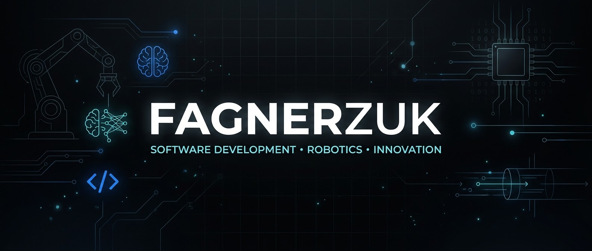
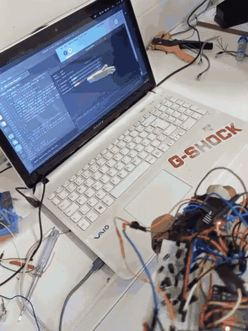
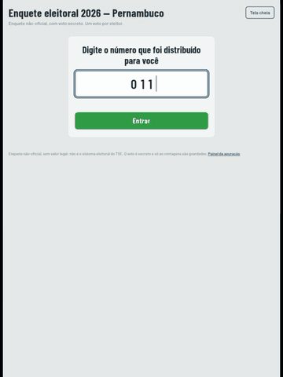
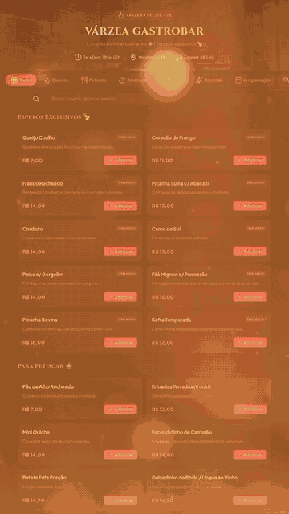

  

Hi, I'm Fagner 👋

Software Development • Robotics • Innovation

I'm a technology enthusiast and developer interested in building practical solutions through software engineering, artificial intelligence, and embedded systems.

I enjoy exploring how technology can solve real-world problems — from web applications for local businesses to assistive technology and hardware-based systems.

---

👨‍💻 About Me

- 💻 Interested in Software Engineering, Backend Development, and Artificial Intelligence.
- 🤖 Exploring Robotics, Embedded Systems, and Electronics.
- 🌐 Building web solutions focused on usability and real-world applications.
- 🧠 Learning new technologies and improving my problem-solving skills.
- 🚀 Interested in developing technology that makes a meaningful difference.

My approach is based on continuous learning, experimentation, and practical development.

---

🛠️ Technologies & Tools

Programming & Web Development

  
  
  
  
  

Hardware & Engineering

  
  
  

Development Tools & AI

  
  
  
  
  

I use AI tools as development assistants for research, planning, implementation, debugging, and improving solutions — while continuously developing my own technical skills.

---

🚀 Featured Projects

🦾 ParkinSense — Assistive Technology

An intelligent glove prototype designed to detect involuntary hand tremors and respond through vibrational stimulation.

  

Developed as an academic team project for the 2026 National Robotics Exhibition (Mostra Nacional de Robótica).

Key features and technologies:

- ESP32-based embedded system.
- MPU6050 accelerometer and gyroscope.
- Five vibration motors and individual LED indicators.
- Tremor signal analysis using the Goertzel algorithm.
- Hann windowing and frequency-based detection.
- State machine controlling measurement and stimulation cycles.
- Real-time serial telemetry and 3D visualization using Processing.

Important: This is an academic prototype. Its detection and response behavior was evaluated using synthetic signals and simulation. Tremor reduction has not been measured, and the device has not undergone clinical validation or testing on people with Parkinson's disease.

Team: Fagner da Silva Pereira Filho, Kauhan Rodrigues de Melo, and Miguel Macedo do Nascimento.

"View ParkinSense Repository" (https://github.com/dev-KauhanMelo/parkinsense-luva)

---

🗳️ Electronic Voting Simulator

A non-official election polling and vote-counting application designed to simulate a complete voting process.

  

Developed for a simulated electoral poll involving candidates from Pernambuco and Brazil.

Key features:

- Sequential voting interface for multiple electoral positions.
- Support for blank and null votes.
- Voter number validation and duplicate prevention within each device.
- Results dashboard with candidate rankings and percentages.
- Party-based vote statistics.
- CSV data export and import between devices.
- Candidate data generation using Python scripts.

Technologies: HTML, CSS, JavaScript, Python, and browser LocalStorage.

Note: This is an educational polling simulator, not an official election system. Data is stored locally on each device; synchronization between devices requires manual export and import.

"View Electronic Voting Repository" (https://github.com/Fagnerzuk/urnaeletronica)

---

🌐 Local Business Digital Solutions

I also develop digital presence solutions for small businesses, helping them improve their online visibility and communication with customers.

  

My work includes:

- Landing Pages: Responsive websites presenting businesses, services, and contact information.
- Digital Catalogs: Organized product and service displays.
- WhatsApp Integration: Direct communication, customer inquiries, and business contact.
- Custom Web Experiences: Interfaces designed around each business's needs.

Technologies and tools: HTML, CSS, JavaScript, Lovable, ChatGPT, and Claude.

Selected Work

Business| Digital Solution
"Lord Barbearia" (https://github.com/Fagnerzuk/lord-barbearia-premium)| Barbershop digital presence
"Flor do Bairro" (https://github.com/Fagnerzuk/flordobairro)| Local business website
"Pingo do Céu Burguer" (https://github.com/Fagnerzuk/pingo-do-ceu-burguer)| Restaurant digital presence
"Gastrobar" (https://github.com/Fagnerzuk/gastrobar)| Business web presence

These projects reflect my interest in using technology to solve practical problems and create useful digital experiences.

---

🎯 Current Goals

- Strengthen my foundations in Software Engineering.
- Develop deeper knowledge of Rust and backend development.
- Explore databases, server architecture, and distributed systems.
- Improve my skills in robotics and embedded programming.
- Build more advanced projects combining software and hardware.
- Pursue international academic and professional opportunities.

---

📊 GitHub Statistics

  
  

  

---

🤝 Let's Connect

I'm always interested in learning, exchanging ideas, and connecting with people passionate about technology and innovation.

  
  
  

---

  <i>Building, learning, and exploring what's possible through technology.</i>

